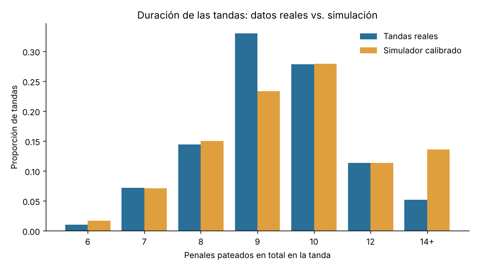
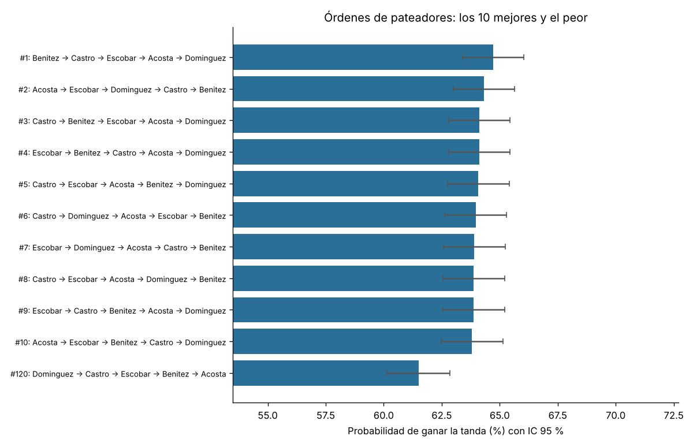

# Tandas de penales: análisis de datos reales y asistente para elegir el orden de pateadores

TP2 individual – Programación Orientada a Datos (UCA)
Autor: Juan Manuel Rodon


---

## 1. Problema, usuario y solución

### El problema

Cuando un partido de eliminación se define por penales, el cuerpo técnico tiene
pocos minutos para decidir **quiénes patean y en qué orden**. Hoy esa decisión
se toma con intuición ("el mejor patea primero", "el más tranquilo patea el
quinto"), y hay dos dificultades para hacerlo con datos:

1. Una tanda tiene muchísimo azar. Con un par de tandas jugadas no se puede
   saber si un orden fue bueno o si se tuvo suerte.
2. No todos los penales pesan igual. Un penal que **si se erra se pierde** se
   patea bajo una presión distinta, y los jugadores no la toleran igual.

### Usuario

Un **analista o ayudante de campo** de un equipo de fútbol que tiene las
estadísticas de penales de su plantel (por ejemplo, de entrenamientos) y quiere
llegar al partido con el orden de pateadores ya decidido y justificado.
También le sirve a un periodista o estudiante que quiera saber cómo son las
tandas reales en los grandes torneos.

### Solución propuesta

Una aplicación de consola que:

1. **Analiza 97 tandas reales** (Mundiales, Eurocopas y Copas América,
   1976–2026). Calcula cuántos penales se convierten, cuánto duran las tandas y
   cuántas llegan a muerte súbita, por torneo y por década, y valida que cada
   marcador sea posible según el reglamento.
2. **Calibra un simulador** con esos datos: busca la efectividad base que hace
   que las tandas simuladas conviertan lo mismo que las reales.
3. **Valida el simulador** comparando la duración de las tandas simuladas con la
   de las reales.
4. **Simula el partido del usuario**, penal por penal, con sus pateadores, su
   arquero y el rival, siguiendo el reglamento real: 5 penales alternados, fin
   anticipado cuando un equipo ya no puede alcanzar al otro y muerte súbita.
5. **Recomienda el orden**: prueba los 120 órdenes posibles de los 5 pateadores
   elegidos, los ordena por probabilidad de ganar y verifica con otra semilla si
   la mejora sobre el orden actual es real o puede ser ruido de la simulación.

### Operaciones disponibles

| operación | qué responde |
|---|---|
| `historico` | ¿Cómo son las tandas reales? Admite filtros por torneo y por rango de años. |
| `validar-modelo` | ¿El simulador produce tandas parecidas a las reales? |
| `simular` | ¿Qué probabilidad tiene mi equipo de ganarle la tanda a este rival con este orden? |
| `recomendar-orden` | ¿En qué orden conviene patear? ¿Cuánto mejora respecto del orden actual? |

### Alcance de esta versión

**Incluye:**

- tandas de selecciones masculinas en tres torneos;
- efectividad individual de cada pateador;
- ajuste por arquero;
- efecto de la presión según el "temple" de cada jugador;
- sorteo de quién patea primero;
- muerte súbita con el resto del plantel.

**Queda afuera:**

- datos penal por penal y por jugador real;
- dirección del remate o del arquero;
- cansancio y cambios;
- elección automática de *quiénes* patean entre todo el plantel (se elige a los
  5 de mayor efectividad o se indican por nombre);
- interfaz gráfica o web.

---

## 2. Datos

Detalle completo de fuentes, licencias, variables y limitaciones en
[`data/README.md`](data/README.md). En resumen:

| archivo | contenido | unidad de análisis | fuente |
|---|---|---|---|
| `tandas_historicas.csv` / `.json` | 97 tandas, 935 penales, 11 variables | una tanda real | RSSSF (copia permitida con reconocimiento al autor), consultada el 11/11/2026; control cruzado con Wikipedia (CC BY-SA) |
| `planteles.csv` / `.json` | 2 equipos ficticios, 16 pateadores y 2 arqueros | un jugador | sintéticos, creados por el autor |
| `tandas_con_errores.csv` | 12 registros, 10 con errores | una tanda | creado para demostrar la limpieza |

Los archivos CSV y JSON de cada conjunto son equivalentes, y las pruebas lo
comprueban.

---

## 3. Instalación y uso

Requiere **Python 3.10 o superior** (probado con 3.13). El programa usa solo
la biblioteca estándar. `matplotlib` es **opcional**: si está instalado, se
generan los gráficos en PNG y, si no, se generan igual las tablas.

```
git clone https://github.com/juaanma/tp2-rodon.git
cd tp2-rodon
pip install -r requirements.txt     # opcional, solo para los gráficos
```

Todos los comandos se ejecutan desde la carpeta del repositorio. Los
resultados se guardan en `outputs/`, o en la carpeta que se indique con
`--salida`.

```
# 1. Analizar las tandas reales (todas, o filtradas)
python -m src.main historico
python -m src.main historico --torneo "Copa America" --desde 2000
python -m src.main historico --historico data/tandas_historicas.json

# 2. Comparar el simulador calibrado con las tandas reales
python -m src.main validar-modelo

# 3. Probabilidad de que NOR le gane a SUR con un orden dado
python -m src.main simular --equipo NOR --rival SUR --pateadores Acosta Benitez Castro Dominguez Escobar

# 4. Mejor orden para NOR contra SUR
python -m src.main recomendar-orden --equipo NOR --rival SUR

# Demostración de la limpieza con un archivo con errores
python -m src.main historico --historico data/tandas_con_errores.csv
```

Opciones de simulación (comandos 2 a 4):

| opción | por defecto | significado |
|---|---|---|
| `--repeticiones` | 5000 | tandas simuladas por cada caso |
| `--semilla` | 2026 | misma semilla, mismos resultados |
| `--presion` | 0.25 | caída máxima de efectividad bajo presión (0 = sin efecto) |
| `--empieza` | sorteo | quién patea primero: `A` (el equipo), `B` (el rival) o `sorteo` |
| `--planteles` | `data/planteles.csv` | archivo de planteles (.csv o .json) |
| `--torneo`, `--desde`, `--hasta` | todas | qué tandas reales se usan para calibrar (también filtran `historico`) |

Ayuda: `python -m src.main --help` o `python -m src.main recomendar-orden --help`.

### Ejecutar las pruebas

```
python -m unittest
```

Hay 52 pruebas y tardan unos 2 segundos. También se pueden correr de a una,
por ejemplo `python -m unittest tests.test_modelos`.

---

## 4. Organización del código y decisiones de diseño

```
tp2-rodon/
├── README.md
├── requirements.txt         matplotlib (opcional)
├── data/                    datos de entrada y su documentación
├── docs/                    gráficos de ejemplo usados en este README
├── src/
│   ├── fuentes.py           lectura: FuenteDatos, FuenteCSV, FuenteJSON
│   ├── modelos.py           dominio: reglas de la tanda, TandaHistorica, Pateador, Arquero, Equipo
│   ├── pipeline.py          inspección, esquema, limpieza, análisis, planteles, guardado
│   ├── simulacion.py        ModeloPenales, simulación, calibración, ranking de órdenes
│   ├── graficos.py          gráficos opcionales
│   └── main.py              argumentos de consola y coordinación de cada operación
└── tests/                   pruebas con unittest
```

### Flujo de cada operación

```
leer (FuenteCSV/FuenteJSON) → inspeccionar (registros, columnas, vacíos)
→ validar esquema → limpiar (válidos + rechazos con motivo)
→ analizar / calibrar / simular → verificar → guardar en outputs/ y mostrar
```

### Por qué cada concepto

- **Abstracción para las fuentes (`FuenteDatos` → `FuenteCSV`, `FuenteJSON`).**
  El programa lee dos tipos de archivo (tandas y planteles) en dos formatos.
  La clase base define el contrato `cargar(ruta)` y controla lo común: archivo
  inexistente, archivo vacío y codificación. Cada subclase implementa solo
  `_leer`. Después de cargar, ninguna función sabe de qué formato vino el dato.
  `elegir_fuente` elige la clase por la extensión.
- **`TandaHistorica`.** Reúne los datos de una tanda real y su comportamiento:
  `conversion()`, `llego_a_muerte_subita()`, `pateo_primero()` (deducido de la
  cantidad de tiros) y `clave()` para detectar duplicados. Se valida a sí misma
  al construirse, así no puede existir una tanda inválida dentro del programa.
- **`Pateador`, `Arquero`, `Equipo`.** Modelan lo que decide el usuario.
  - `Pateador.efectividad_bajo_presion()` aplica el efecto del temple.
  - `Arquero.ajustar()` modifica la probabilidad del rival y la acota.
  - `Equipo` valida que el plantel sea usable: al menos 5 pateadores, nombres
    sin repetir y un arquero. Ofrece `mejores()` y `orden_completo()` para la
    muerte súbita.
- **`ModeloPenales`.** Encapsula el supuesto de presión (un parámetro) y la
  regla para calcular la probabilidad de cada penal. Cambiar el modelo no
  obliga a tocar el resto del código.
- **Una sola regla del reglamento (`tanda_decidida`).** La usan tanto el
  simulador, para saber cuándo termina una tanda, como el validador de datos
  reales, para saber si un marcador es posible. Así una tanda real y una
  simulada se juzgan con la misma regla, y una prueba comprueba que toda tanda
  simulada pasa la validación de las reales.
- **Funciones con una responsabilidad cada una** en `pipeline.py` y
  `simulacion.py`: `inspeccionar`, `validar_esquema`, `limpiar_historico`,
  `filtrar_historico`, `analizar_historico`, `comparar_con_modelo`,
  `construir_equipos`, `calibrar_efectividad`, `simular_enfrentamiento`,
  `recomendar_orden`, `verificar_ranking`, `guardar_csv`, `guardar_json`.
  Reciben datos ya cargados y devuelven resultados, sin imprimir. Solo
  `main.py` imprime, y eso permite probarlas por separado.
- **Estilo funcional donde ayuda.** Comprensiones y `sum`/`Counter` para los
  agregados, y funciones puras para las reglas, sin efectos secundarios.

### Expresiones regulares (en `modelos.py`)

| patrón | campo | qué valida | qué se comprueba aparte |
|---|---|---|---|
| `(MUN\|EUR\|CAM)-(\d{4})-(\d{2})` | id de tanda | formato torneo-año-número | que el prefijo corresponda al torneo y el año del id al campo `anio` (se usan los grupos capturados) |
| `(\d{1,2})-(\d{1,2})` | resultado del partido | formato `goles-goles` | que sea **empate**: sin empate no hay penales |
| `F\|SF\|QF\|3/4\|[1-3]R` | ronda | que sea una ronda conocida | — |
| `[A-Z]{3}` | código de equipo (planteles) | tres letras mayúsculas | — |

Se usa `fullmatch`, así que no se acepta texto de más (por ejemplo,
`MUN-2022-05x`). La regex del año solo mira que haya 4 dígitos, y por eso
además se controla que esté entre 1976 (primera tanda de los datos) y el año
actual.

### Validaciones

**Tanda real.** Se rechaza, con su motivo, cuando:

- falta un campo o está vacío;
- algún número no es entero;
- el ganador y el perdedor son el mismo equipo;
- un equipo convirtió más penales que los que pateó;
- el ganador no convirtió más que el perdedor;
- el marcador **no puede darse con el reglamento**.

El último control recorre todos los estados posibles de la tanda, pateando
primero cualquiera de los dos equipos. Así detecta, por ejemplo, que un 5-3
con 5 tiros cada uno es imposible, porque la tanda habría terminado antes del
quinto penal.

**Planteles.** Se controla:

- que las probabilidades estén en rango (también se rechaza `NaN`);
- que el rol sea conocido;
- que cada equipo tenga exactamente un arquero y al menos 5 pateadores.

**Resultados.**

- `verificar_ranking` comprueba que haya 120 órdenes distintos con
  probabilidades válidas.
- La mejora del mejor orden se **vuelve a medir con otra semilla**.

**Errores.** Los errores de lectura o de parámetros se muestran con un mensaje
claro y el programa termina con código 1, sin traceback.

---

## 5. Decisiones de limpieza

- **No se corrige ni se inventa ningún dato real.** Un registro dudoso se
  rechaza y queda en `outputs/historico_rechazos.csv` con el número de registro,
  el id y el motivo. Con los datos reales hay 0 rechazos. Con
  `tandas_con_errores.csv` se rechazan 10 de 12.
- **Duplicados.** Si se repite el id, o el mismo partido aparece con otro id
  (mismo torneo, año, ronda y equipos), se conserva el primero.
- **Faltantes en planteles.** Se tratan de forma explícita y nunca como cero:
  - efectividad vacía → efectividad calibrada con datos reales, y el jugador se
    marca como estimado y se avisa en pantalla;
  - temple vacío → 0.5;
  - factor de atajada vacío → 0.
- **Filas inválidas en planteles.** Se rechazan y quedan en
  `outputs/planteles_rechazos.csv`. Si por eso un equipo queda incompleto, se
  descarta el equipo entero.

---

## 6. Ejemplos de resultados

### Tandas reales (`python -m src.main historico`)

```
97 tandas, 935 penales: conversión 73.2% (IC 95 %: 70.3%–76.0%)
Penales por tanda: 9.639 | llegan a muerte súbita: 16.5%

grupo          tandas  conversión  muerte súbita
1980s               6       83.6%          33.3%
1990s              26       78.7%          23.1%
2000s              15       69.9%          20.0%
2010s              26       72.6%           7.7%
2020s              23       65.4%          13.0%
Copa America       33       75.2%          21.2%
Eurocopa           25       77.0%          24.0%
Mundial            39       68.6%           7.7%
```

**Interpretación.**

- Se convierte un poco menos de 3 de cada 4 penales.
- En los Mundiales se convierte menos (68.6 %) que en la Eurocopa (77.0 %).
- La conversión baja con las décadas: 78.7 % en los 90 y 65.4 % en los 2020.
  Esa diferencia sí supera el error de muestreo: los intervalos de confianza
  (en `historico_por_grupo.csv`) son 73.6–83.7 % y 59.0–71.8 % y no se
  superponen. La diferencia entre Mundial y Eurocopa, en cambio, tiene
  intervalos que se superponen un poco.
- Los datos no dicen *por qué* baja la conversión. Una hipótesis es una mejor
  preparación de los arqueros, por ejemplo con análisis de video, pero con
  estos datos no se puede comprobar.
- **Consecuencia para el simulador:** por defecto se calibra con todo el
  histórico. Para representar el fútbol actual, se puede calibrar solo con
  tandas recientes agregando `--desde 2010` a cualquier comando de simulación.

### ¿El simulador se parece a la realidad? (`validar-modelo`)

```
Conversión real: 73.2% → efectividad base calibrada (presión 0.25): 74.0%

medida                          real  simulado    dif.
conversion                     0.732     0.730  -0.002
tiros_promedio                 9.639    10.306  +0.667
prop_muerte_subita             0.165     0.250  +0.085
```



**Interpretación.** El modelo se calibró solo con la conversión, pero
reproduce bien la duración de las tandas que terminan en los 5 penales (7, 8,
10 y 12 tiros).

Sobreestima la muerte súbita: 25 % simulado contra 16.5 % real. La
explicación más probable es que el modelo de validación usa dos equipos
**iguales**, y en la realidad un equipo suele ser algo mejor que el otro, lo
que hace menos frecuente el empate tras 5 penales.

El modelo **con presión** se acerca más a la realidad que **sin presión**:
`--presion 0` da 28.9 % de muerte súbita. Esto apoya, aunque no prueba,
incluir el efecto de la presión.

### Recomendación de orden (`recomendar-orden --equipo NOR --rival SUR`)

```
Mejor orden:  Benitez → Castro → Escobar → Acosta → Dominguez  64.7%
Orden actual: Acosta → Benitez → Castro → Dominguez → Escobar  62.2% (puesto 101)
Peor orden:   Dominguez → Castro → Escobar → Benitez → Acosta  61.5%

Verificación con otra semilla (2027): el mejor orden supera al actual por +2.0 puntos (IC 95 %: +0.1 a +3.8).
Conclusión: cambiar el orden mejora la probabilidad de ganar.
```



**Interpretación.** El orden "intuitivo" (de mayor a menor efectividad) deja
a Escobar, el de menos temple (0.20), en el quinto penal, que es el que más
veces se patea con la tanda en juego. El mejor orden pone en ese lugar a
Dominguez (temple 0.85) y adelanta a los que se ponen nerviosos. La ganancia
es de unos 2 puntos porcentuales: no es enorme, pero es gratis.

Con `--presion 0` la diferencia entre el mejor y el actual **no es
significativa** (+0.6 puntos, IC de −1.2 a +2.5). Es lo esperable: si la
presión no existe, el orden no influye, porque cada penal es independiente.

Por eso la recomendación depende del supuesto de presión, y el usuario puede
probar distintos valores para ver si la conclusión se mantiene.

### Archivos generados en `outputs/` (no se versionan, se regeneran)

| archivo | contenido |
|---|---|
| `historico_resumen.json` | medidas generales, por grupo, distribución y quién empieza |
| `historico_por_grupo.csv` | tabla por torneo y década con IC 95 % |
| `historico_rechazos.csv` / `planteles_rechazos.csv` | registros rechazados y motivo |
| `validacion_modelo.csv` / `.png` | comparación real vs. simulado |
| `simulacion_NOR_vs_SUR.json` / `_tandas.csv` | parámetros, resumen y cada tanda simulada |
| `orden_NOR_vs_SUR.csv` / `.json` / `.png` | ranking de los 120 órdenes y verificación |

---

## 7. Pruebas

| archivo | qué prueba |
|---|---|
| `test_fuentes.py` | lectura CSV/JSON, **equivalencia de ambas lecturas**, archivo inexistente, vacío, JSON mal formado o con estructura incorrecta |
| `test_modelos.py` | reglas de fin de la tanda, marcadores reales posibles e imposibles, cada regex con casos inválidos, presión, arquero y validaciones de equipo |
| `test_pipeline.py` | limpieza con el archivo de errores (cada rechazo), duplicados, análisis con **valores conocidos** (26 tiros, 23 goles), **conservación**: la suma por torneo es igual al total, filtros, faltantes de planteles |
| `test_simulacion.py` | reproducibilidad con semilla, caso extremo (termina 3-0 con 6 tiros), **toda tanda simulada cumple el reglamento**, temple 1 anula la presión, calibración, ranking de 120 órdenes |
| `test_main.py` | ejecución de punta a punta, reproducibilidad del programa completo y mensajes de error |

---

## 8. Limitaciones

- **La presión es un supuesto, no una medición.** Los datos no dicen qué penal
  se erró en qué situación. El parámetro `--presion` permite ver cuánto
  depende la recomendación de ese supuesto.
- **Las efectividades y el temple de los planteles son de ejemplo.** El valor
  de la recomendación depende de que el usuario cargue estadísticas reales de
  sus jugadores. Con pocos penales por jugador, la efectividad estimada es poco
  precisa.
- **Supuestos del modelo.** Supone penales independientes, salvo por la
  presión, y que un arquero afecta a todos los pateadores por igual.
- **Contexto de los datos.** Los datos reales son de selecciones masculinas en
  tres torneos, y la conversión puede ser distinta en otros contextos.
- **Error de simulación.** Los resultados son estimaciones: por eso se informan
  intervalos de confianza. Con 5000 repeticiones, el error ronda ±1.3 puntos
  porcentuales.
- **Reproducibilidad.** Está garantizada con la misma semilla y la misma
  versión de Python, porque `random.Random` puede cambiar entre versiones.

---

## 9. Entrega

- Versión evaluada: etiqueta **`v2.0`**. La etiqueta `v1.0` corresponde a la
  primera entrega (simulador de escenarios con dos probabilidades).
- Cambios respecto de `v1.0`:
  - se agregaron datos reales;
  - el modelo pasa a ser por jugador, con arquero y presión;
  - se agregaron la calibración y la validación del modelo;
  - se agregó la recomendación de orden con verificación;
  - hay nuevas validaciones (reglamento y regex);
  - se amplió la documentación;
  - hay 52 pruebas.
